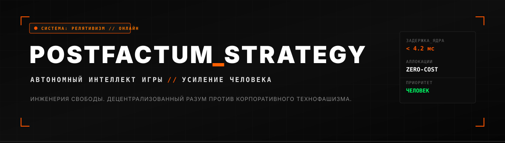

<div align="center">

<a href="https://github.com/PostFactum-Strategy">
  
</a>

<br>

<p align="center">
  <kbd>&nbsp;СВОБОДА ИНФОРМАЦИИ&nbsp;</kbd>&nbsp;&nbsp;
  <kbd>&nbsp;АНТИ-ДИКТАТ&nbsp;</kbd>&nbsp;&nbsp;
  <kbd>&nbsp;НАШИ ДАННЫЕ&nbsp;</kbd>&nbsp;&nbsp;
  <kbd>&nbsp;ЖИВОЙ РАЗУМ&nbsp;</kbd>
</p>

```text
>>> POSTFACTUM STRATEGY // ОРГАНИЗАЦИЯ СВОБОДНЫХ ИССЛЕДОВАТЕЛЕЙ // 2026
>>> СТАТУС: МАНИФЕСТ ОТКРЫТОГО РАЗУМА // БЕЗ КОМПРОМИССОВ
```

</div>

---

### Манифест: Свобода Информации или Цифровая Тюрьма

Свободы информации больше нет. Ее методично, хладнокровно и планомерно отбирают каждый божий день.

Корпоративная паранойя платформ перешла любые грани здравого смысла. Дошло до абсурда: сегодня игрока заставляют чувствовать себя преступником просто за то, что на его собственном компьютере запущена операционная система, открыт браузер или работают базовые инструменты. Скоро аккаунты начнут блокировать только за то, что у человека включен Windows и он посмел включить монитор.

Технократы навязывают сообществу свой стерильный, лицемерный сценарий:
* *«Вам не положена информация. Вы не имеете права знать, что происходит внутри.»*
* *«Вы все обязаны быть одинаковыми. Вы должны бездумно шагать по усредненному бейзлайну, который мы для вас нарисовали.»*
* *«Не смейте думать, не смейте считать, не смейте анализировать. Сидите тихо перед нашим черным ящиком, в котором мы крутим правила как нам вздумается.»*

**Наш ответ предельно прост: этому не бывать.**

---

### Мы не просим подачек. Верните то, что наше

Мы не стоим с протянутой рукой и не выпрашиваем у платформ снисхождения, поблажек или особых условий. 

Мы говорим прямо: **отдайте нам то, что и так принадлежит нам по праву.**

* Каждая сыгранная раздача — это труд, время и деньги живого человека.
* Каждая строка истории — это наши действия, наши решения и наша интеллектуальная собственность.
* Право анализировать свою игру, понимать математику мира и свободно мыслить — неотъемлемо.

Не смейте отнимать у людей то, что создано ими. Попытка загнать свободное сообщество в загон, где запрещено думать своим умом, а любая попытка разобраться объявляется ересью — это технологический тупик.

---

### Прямое Предупреждение Монополиям

Если платформы продолжат закручивать гайки, превращать интеллектуальную игру в полицейское государство и уничтожать живое сообщество ради сохранения своей непрозрачной монополии — они проиграют.

> Сила всегда была и будет на стороне свободного человеческого разума. На любые закрытые шлюзы, искусственные запреты и попытки ослепить игроков найдется ответ, который превзойдет всю корпоративную систему на три головы вперед.

Мы здесь не для того, чтобы встраиваться в чужие правила. Мы здесь для того, чтобы защитить право людей оставаться мыслящими, сильными и свободными.

---

<div align="center">

```text
+-----------------------------------------------------------------------+
|  POSTFACTUM STRATEGY // СВОБОДА. ИНФОРМАЦИЯ. СООБЩЕСТВО.              |
|  ТЕХНОЛОГИИ НА СЛУЖБЕ ЛЮДЕЙ. МЫ НЕ ОТСТУПИМ.                          |
+-----------------------------------------------------------------------+
```

<sub>PostFactum Strategy. Создано идейными разработчиками во имя свободного сообщества.</sub>

</div>
