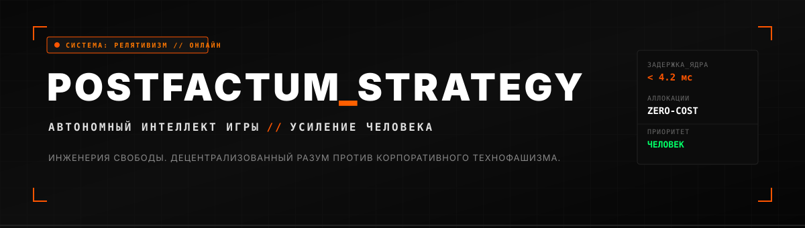
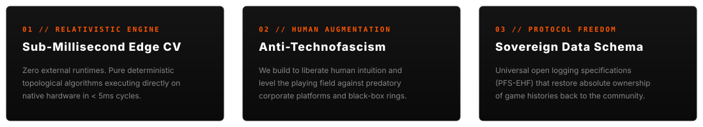

<div align="center">



<br>

```text
[POSTFACTUM STRATEGY] // РЕЛЯТИВИСТСКИЙ ИНТЕЛЛЕКТ // УСИЛЕНИЕ ЧЕЛОВЕКА // 2026
```

[](https://github.com/PostFactum-Strategy)
[](https://github.com/PostFactum-Strategy)
[](https://github.com/PostFactum-Strategy)

</div>

---

### Манифест

Мы — независимое инженерное объединение разработчиков системного софта, математиков и исследователей Computer Vision. Мы не строим корпоративные воронки для выкачивания данных и не обслуживаем платформенных монополистов.

Мы строим технологии, чтобы изменить баланс сил.

Современный цифровой мир незаметно скатился в алгоритмический феодализм и технофашизм. Централизованные корпорации выкачивают приватную информацию игроков, скрывают реальную честность игры за непроницаемыми стенами закрытых серверов, подавляют живую человеческую интуицию и одновременно закрывают глаза на хищные автоматизированные бот-синдикаты.

Мы отвергаем эту модель.

**PostFactum Strategy** создана на фундаментальной идее: технологии обязаны служить освобождению человека, прозрачности математических правил и защите независимого сообщества. Наш мир держится не на алгоритмическом диктате, а на взаимопомощи, свободе воли и открытом доступе к инструментам анализа. Мы реализуем релятивистские, сверхскоростные проекты, цель которых — усилить восприятие живого игрока, защитить комьюнити от манипуляций и вернуть покеру дух честного интеллектуального противостояния.

---

<div align="center">

</div>

---

### Инженерные принципы

```
+-----------------------------------------------------------------------------+
| 01. РЕЛЯТИВИСТСКАЯ СКОРОСТЬ                                                 |
| Никакого Python на критических путях. Нулевые накладные расходы рантайма.   |
| Чистые нативные алгоритмы, исполняющиеся на железе с откликом менее 5 мс.   |
+-----------------------------------------------------------------------------+
| 02. РАДИКАЛЬНЫЙ СУВЕРЕНИТЕТ ДАННЫХ                                          |
| История игры принадлежит тем, кто ее создал — самим игрокам, а не румам.    |
| Универсальный, высокоточный открытый стандарт телеметрии раздач.            |
+-----------------------------------------------------------------------------+
| 03. МОДУЛЬНАЯ ИЗОЛЯЦИЯ                                                      |
| Полное разделение контуров: оптическое зрение, парсинг логов и прямой вывод |
| оверлея работают как независимые, математически изолированные сущности.     |
+-----------------------------------------------------------------------------+
```

#### Детерминированное зрение на уровне железа
Вместо неповоротливых многогигабайтных нейросетей, которые сжигают ресурсы процессора и зависят от чужих облаков, мы разрабатываем зрение на базе первых математических принципов. Топологический анализ контуров, масштабно-инвариантная геометрия столов и адаптивные цветовые пространства дают мгновенное понимание сцены с задержкой в доли миллисекунды.

#### Свобода открытого протокола
Мы формируем открытый стандарт описания игровых сессий, позволяющий игрокам независимо валидировать математические ожидания, восстанавливать целостность раздач и защищаться от скрытых аномалий без привязки к проприетарному софту операторов. Каждая раздача — это теорема; каждая сессия — суверенная собственность игрока.

#### Усиление, а не замена человека
Мы убеждены, что будущее технологий — это симбиоз, а не вытеснение человека бездушным кодом. Наши решения создаются для того, чтобы помочь живому игроку ориентироваться в сложных многомерных деревьях решений, видеть скрытые асимметрии информации и чувствовать уверенность за любым столом.

---

### Траектория: куда мы идем

Наш вектор развития подчинен идее децентрализации и технической поддержки сообщества:

1. **Единый мультирумный стандарт**: сведение логов и потоков любых покерных комнат к единому прецизионному протоколу без потерь.
2. **Математический аудит честности**: предоставление игрокам открытых инструментов для проверки дисперсии и выявления скрытого командного сговора (коллизии).
3. **Неинвазивная нативная телеметрия**: работа исключительно через Win32 composited overlay без вмешательства в память чужих процессов и без нарушения приватности системы.

---

### Принцип архитектурной автономии

Внутри экосистемы PostFactum Strategy каждый репозиторий решает строго свою прикладную инженерную задачу. Ядра высокочастотных вычислений, математические солверы и низкоуровневые модули зрения остаются проприетарными для защиты от коммерческой эксплуатации платформенными монополиями.

Публично мы демонстрируем наши идеи, наши открытые форматы и стандарты честности. Закрытыми остаются механизмы, дающие нашим соратникам математическое преимущество.

---

```text
[POSTFACTUM STRATEGY] // СУВЕРЕННОЕ ЯДРО // ВСЕ ПРАВА ЗАЩИЩЕНЫ // 2026
```

<div align="center">
  <sub>Разработано PostFactum Strategy. Создано для людей. Не для корпораций.</sub>
</div>
